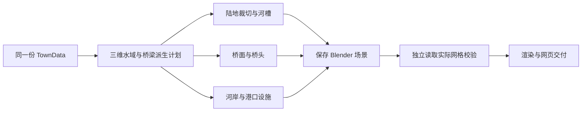

# 河流穿城城市生成实现方案

本方案面向现有城镇生成器的线稿淡彩三维流程。二维已经具备河流穿城、两岸街区、滨水道路和跨河桥梁；下一步应把同一份规划完整装配成三维，补齐河槽、两岸、桥梁和结构校验。首版沿用已有河流开关及规划数据，优先完成可从网页和命令行生成、保存、恢复和验证的闭环。

建议先交付内陆单河城市，再交付河流与海岸组合。首版以平桥为基础，石拱桥、通航高度、内河码头和水车放在后续。现有港口素材已覆盖水材质、石护岸和部分配件，首批新增资源集中在桥梁构件与河岸过渡，无需先购买整套城市资源。

## 当前基础与主要缺口

| 环节 | 当前能力 | 本次处理 |
| --- | --- | --- |
| 二维规划 | `terrain.ts` 在道路和建筑前规划实际河面及岸带，裁切地块，建立两岸道路和桥梁，并修整城墙 | 作为输入基线，先做回归与样本筛选 |
| 桥梁数据 | `river.bridges` 已含 `id`、`roadId`、`points`、`width`，桥端与道路共享连接点 | 按原位置装桥，保留全部来源关系 |
| 三维适配 | `export-minimal-town.mjs` 已原样复制 `river` 和 `terrain`，并断言一致 | 保持源规划，增加三维派生记录 |
| 水陆几何 | 内陆场景目前是完整矩形地板；港口裁地只支持单侧海岸 | 增加河流裁地和河槽，支持两片以上陆地 |
| 道路与桥 | 三维目前把全部道路铺在同一高度，并统一补路口 | 按桥梁的 `roadId` 单独装配桥路及桥头 |
| 河海组合 | 港口装配器也主动拒绝河流 | 统一水域和陆地，避免两个装配器重复创建地面 |
| 使用入口 | 网页、服务端、CLI 都主动拒绝含河流规划 | 完成对应能力和校验后同步开放 |
| 独立验证 | 已验证建筑、普通道路、城防和港口实际网格 | 增加河道、桥梁、桥头和河海接口验证 |

当前主生成入口是 `generator.ts → SkeletonModel → buildTerrainTown`；`river.ts` 中的 `addRiver` 用于旧格式兼容，不作为本次开发入口。

## 首版范围与生成效果

首版需要生成一条贯穿已开发城区的河流，两岸都有实际街区和滨水通路，至少一座桥连接两岸。水面使用源规划的弯曲、变宽边界；桥位、桥宽、建筑占地、街区和城墙开口均可追溯到二维规划。默认三维取景应同时看到河道、两岸建筑和一座主要桥梁。

支持已有 `river=true`、城墙和城堡组合。先开放内陆单河；完成河海交界与港口回归后，再开放四向海岸的河口城市。先保持静态平水面，使用与当前港口一致的水位基准。支流、岛屿、湖泊、高差流水、动态水模拟和航运系统属于后续范围。

二维当前没有河宽、流向或桥数的用户参数。首版接通已有结果；若后续需要可控构图，再增加河流方向、宽窄和桥型配置。

## 所需资源

### 可复用资源

现有 `artifacts/harbor-assets/` 含 12 个模块及可编辑库、GLB、纹理、清单和校验报告，可以直接作为美术基础。

| 资源 | 当前资产或模块 | 复用方式 |
| --- | --- | --- |
| 淡彩水面 | `harbor_sea_01` 的 `water`、`water_light` 材质 | 按河面多边形重新建网格；水纹方向改为沿河流切线 |
| 石砌护岸 | `harbor_quay_01` | 用于已开发的滨水道路一侧，沿河岸切向拼装 |
| 护岸转角与台阶 | `harbor_quay_corner_01`、`harbor_quay_steps_01` | 适配弯岸和下水点；台阶作为可选细节 |
| 木板及木石材质 | `harbor_dock_deck_01`、现有木石材质槽 | 复用板材外观与拼缝规则，桥梁另设梁架和支承 |
| 树木及城市场景 | 现有小镇素材库、建筑和人物装配 | 继续服从原占地，补充水域及桥头避让 |
| 小船与系泊配件 | 划艇、渔船、系船桩 | 后续适配内河；首版无需自动放船 |
| 水面排除与验证 | `harbor_water.py`、`verify_harbor.py` | 河海统一水体或河中放船时推广已有船舱排水规则 |
| 线稿淡彩渲染 | `illustration_v2.py` 与现有取景管线 | 统一桥、护岸和建筑的轮廓、色彩与排线 |

港口木桩不是现成的桥梁承重套件，大型商船也不应直接放入窄河。素材可以复用外观，但安装规则需要按桥梁和河道重新定义。

### 首批新增资源

建议首批准备以下 **7 个模块或参数化配方**。表中的 ID 为拟用名称，尚未制作。

| 优先级 | 拟用资源 | 交付及装配要求 |
| --- | --- | --- |
| P0 | `river_bank_profile_01` 自然岸与河床配方 | 按实际水边界生成土岸、斜坡、底面及局部碎石；城区外使用自然岸，河床低于水位 |
| P0 | `river_quay_transition_01` 护岸收口 | 衔接既有石护岸、自然岸、桥台；能缩短末段，处理弯岸接缝 |
| P0 | `bridge_timber_deck_01` 木桥面与梁架 | 桥面、纵梁、横梁分部件；按源跨度和宽度组装，避免拉宽木板纹理 |
| P0 | `bridge_timber_support_01` 桥桩与斜撑 | 按跨度布置支承，桩脚进入河床；不默认提供通航能力 |
| P0 | `bridge_abutment_01` 石桥台 | 左右岸分别安装，基础接地；不占据桥头净通行范围 |
| P0 | `bridge_rail_01` 桥栏直段 | 桥两侧独立拼装，按净路宽定位；转向和桥端可以截短 |
| P0 | `bridge_rail_end_01` 栏杆端柱 | 桥头收口，避让沿河道路和共享路口 |

这 7 项包含程序化配方，不表示必须手工制作 7 个固定整模型。水面、河床和岸坡适合程序生成；桥的重复构件适合可编辑模块。先用这些资源完成一套木平桥，可以把最重要的几何和连接问题集中验证。

后续资源按效果补充：

| 阶段 | 资源 | 前置条件 |
| --- | --- | --- |
| P1 | 石拱券、桥墩与分水尖、石栏板、石桥面、引坡 | 明确桥面高程、拱下空间与桥头过渡，不按任意比例拉伸整座石桥 |
| P1 | 芦苇、水草、岸石、岸边步道细节 | 水面及道路避让通过，沿岸密度受控 |
| P2 | 内河码头、平底货船、洗衣台、吊货设施 | 为内河码头补规划语义，检查水路及桥梁空间 |
| P2 | 水车、水磨及专用河岸建筑 | 增加用途、岸边安装范围和占用规则 |

### 资源交付规范

沿用现有素材库方式：交付可编辑 `.blend`、独立 `.glb`、纹理、预览图、机器清单和回读校验报告。材质槽与小镇及港口库保持一致。

- 资产使用米制，`+Z` 向上；桥局部 `+X` 沿跨度，`+Y` 横桥，`Z=0` 为桥面通行基准。
- 标记 `START`、`END`、左右桥缘、桥台安装点和支承位置；记录允许拉伸的轴及范围。
- 区分桥面、栏杆、梁、桩和装饰，分别记录可通行面与占用范围。
- 保留纹理密度，通过增加模块适配长度；石拱券和栏杆不随整桥任意非等比缩放。
- 规划坐标已在核心导出时统一转为米，三维只应用已有 `horizontalScale` 一次。资产尺寸与规划尺寸在装配入口统一换算并记录。
- 参考图或贴图只作为美术输入；验收对象是实际可组装、可编辑的三维资源。

## 数据与几何实现

### 源规划与三维派生计划

保持 `source-town.json` 不变，继续使用现有 `TownData` 和适配器。建议在 `selection.json` 增加独立的三维派生计划，并在 `scene-manifest.json.river` 中记录装配版本、坐标比例、水位、岸段、桥梁实例及跳过原因。

| 现有字段 | 使用方式 |
| --- | --- |
| `river.surface` | 实际水面边界的权威来源；不能用 `centerline + 固定 width` 替代变宽河面 |
| `river.centerline` | 河流方向、水纹切线、局部取样和桥下相对方向 |
| `river.bankWidth` | 岸带参考宽度；不等于精确的岸带外边界 |
| `river.bridges[].points` | 桥梁源路径，保持两端原位置 |
| `river.bridges[].roadId` | 关联道路及两端共享路口，划分桥路和普通道路 |
| `river.bridges[].width` | 桥梁外轮廓宽度的装配依据 |
| 关联 `Road.width` | 净通行带的装配与验证依据，栏杆不能侵入 |
| `terrain.waterfronts` | 根据 `kind=river` 和 `roadId` 定位已开发滨河道路 |
| `terrain.coast`、`terrain.docks` | 河海组合中保留源海面、海岸和沿海码头 |
| `walls.activeSegments` | 只装配源规划有效墙段，不在河上补闭合墙 |

本方案约定将 `Bridge.width` 解释为三维桥面结构总宽，将关联 `Road.width` 解释为净通行宽，并记录在派生计划中。二维当前用桥宽绘制铺面，并未显式定义栏杆语义。当前生成器的两者差额为导出后的 2 米，即每侧 1 米余量，装配时再统一乘 `horizontalScale`。旧规划需先检查桥宽能否容纳道路及侧部结构，空间不足时明确拒绝该三维组合。桥型、结构厚度和高程也是三维解释，不回写成二维原有信息。

当前没有独立导出的精确岸带外边界。首版以 `surface` 固定水边界，以滨河道路和干地街区边界约束岸上安装范围；自然岸在可用空间内过渡，不能为了套固定护岸而移动道路或建筑。若需要完整复现二维保留岸带，可在后续正式扩展河岸字段，并同步严格序列化及兼容测试。

旧 JSON 的 `surface` 是可选字段。首版先对缺失实际河面的旧格式给出明确能力提示并保留二维导入；不得静默重新生成布局。若要开放其三维支持，应将兼容河面推导单独记录，并为其建立独立样本与边界验证。

### 水域与陆地

新增独立于 Blender 的 `river_geometry.py`，负责河面裁切、陆地区域和桥头几何。河口阶段再由共享水域模块协调海、河和陆地。

1. 把源河面与海面裁到当前场景范围内；联合水域只保留一份可见水面，在派生数据中保留河、海来源关系。
2. 计算“场景范围减联合水域”的干地，输出多片多边形并三角化。贯城河通常把陆地分为两岸，不能强行拼回一个无洞多边形。
3. 固定水边界，在陆地侧划出可变宽岸坡带，以 `bankWidth` 作目标宽度预算，避开道路净通行范围、建筑和有效城墙占用。从平地顶面中扣掉实际岸坡带，再生成连接平地、水边和河床的坡面，三者共用边界；空间不足时改用竖直岸壁，记录派生岸带及回退原因。河床放在水位下方，岸壁、基础和底面形成完整河槽，避免重面或侧面的空壳断口。
4. 水面用源 `surface` 建网格；浅水色层和水纹裁在水域内，不能越岸，也不描出内部三角化边。
5. 河口先统一水陆几何，再分别装河岸、海岸和港口设施。删除两套代码各自重建地面的职责，河口内部接缝不生成护岸。

当前 `harbor_geometry.land_ring` 明确只支持单条单调海岸，不能直接用于贯城河。首版几何范围限定单河、无岛无支流；实现应保留多片陆地的表达能力。通用差集与三角化先做代表性样本验证，再确定复用现有裁切函数或增加一个经验证的几何依赖，依赖版本进入缓存签名。

### 桥梁与道路

新增 `bridge_integration.py`，从 `river.bridges` 按稳定顺序装配，每座桥保留 `source_bridge_id` 和 `source_road_id`。

1. 将桥路从普通道路铺装中识别出来，桥面单独成为该道路的实际通行面，保留现有源道路 ID 与检测入口。
2. 首版桥面顶与两端普通道路保持相同标高，采用木平桥，梁架放在下方。避免为造型抬高整座桥，留下桥头台阶。
3. 桥面外缘服从源桥宽，中央完整覆盖关联道路的净宽；栏杆、端柱和桥台布置在通行带外。
4. 普通路口补面与桥头连接联合计算。不能把桥路完全排除后丢失桥头铺装，也不能让桥中心的普通地面铺装盖住水体。
5. 按河床和跨度安装桥桩及桥台，桩脚接河床，两岸桥台接干地。桥下保留水面，但首版不保证船只能通行。
6. 沿河护岸在桥头真实留出口，保留下方挡土结构；栏杆不得横封沿河道路与过桥道路的交叉通路。

当前港口水位为场景 `Z=-1.15`，普通道路顶为 `Z=0.035`。首版复用该基准时，需要检查桥面厚度、梁底和水位的关系。这一间隙不能直接解释为可通航净空。石拱桥阶段需新增桥面高程曲线、引坡长度、坡度及净空契约，并同步更新道路的固定高度校验。

### 两岸城市与城防

开发区附近优先石砌护岸，未开发河段使用自然岸。依据滨河道路、街区边界和可用空间确定安装段，不把全河刷成港口石堤。店面、人物、树木、市场陈设加入水域和桥头通行带避让。

城墙继续严格使用源有效墙段与开口，不为了三维外观自动跨河补墙。墙段末端可在其占用范围内补收口；河上的闸门、铁栅和水门塔作为后续专门构件处理。无法在原规划内安装的装饰可以跳过并记录，桥梁、道路或河道这类必需结构缺失时应失败。

“河流穿城”的效果应检查河道与已开发城区相交、两岸均有城市地块、桥端连入两岸路网。样片挑选通过该检查的规划；若后续要对所有种子保证这一构图，应在二维候选评分与重试阶段加入品质约束，不能只靠相机裁图。

## 工程改动与端到端接入

| 位置 | 建议改动 |
| --- | --- |
| `experiments/3d-sample/river_geometry.py` 新增 | 水陆裁切、岸段、桥头及几何派生；不依赖 Blender，便于单测 |
| `experiments/3d-sample/river_integration.py` 新增 | 河床、水面、河岸及来源标记 |
| `experiments/3d-sample/bridge_integration.py` 新增 | 桥面、梁架、桥台、栏杆及桥头 |
| `experiments/3d-sample/build_river_assets.py` 新增 | 生成首批桥梁与河岸资源库及清单 |
| `experiments/3d-sample/render_sample_v2.py` | 在地面和道路构建阶段接入水域与桥梁；避免仅在渲染末尾叠模型 |
| `experiments/3d-sample/harbor_integration.py` | 河口阶段共享水陆几何，保留港口设施装配；替换内部拒绝河流的逻辑 |
| `experiments/3d-sample/harbor_water.py` | 船体排水改为遍历统一水体及全部浅水、水纹层，替换固定港口对象名称的假设 |
| `experiments/3d-sample/verify_harbor.py` | 支持水体与多片干地对象清单；验证派生并集边界、面积及源区域覆盖，船舱射线覆盖全部水层 |
| `experiments/3d-sample/verify_river.py` 新增 | 独立读取实际网格验证河流与桥梁 |
| `experiments/3d-sample/verify_scene.py` | 接入河流验证；桥路使用对应通行面，普通道路保持原校验强度 |
| `experiments/3d-sample/verify_integrated_assets.py` | 纳入桥梁、桥台、河岸构件及其来源和占用规则 |
| `experiments/3d-sample/render_views.py` | 默认城内取景纳入主要桥梁和两岸城市，避免只看到一侧建筑 |
| `apps/playground/server/three-d-cache.mjs` | 新几何脚本、验证脚本、资源库、机器清单及装配版本纳入分层指纹 |
| `apps/playground/server/three-d-assets.mjs` | 检查河流套件版本，判断已保存场景能否复用 |
| `scripts/generate-3d-sample.mjs` | 更新输入及恢复时的河流能力判断，保留同一源规划 |
| `apps/playground/server/three-d.mjs` | 同步服务端能力判断及河道、桥梁、水域校验阶段进度 |
| `apps/playground/src/three-d.ts` | 按已完成的能力开放按钮，沿用取消、历史、下载和刷新恢复 |

能力判断应区分内陆河、河口、旧格式河面和现有其他限制。完成内陆河后可以先开放该组合，河口继续给出明确提示。网页、后端和 CLI 需要保持一致；仅删除网页禁用条件不能算完成支持。

河海组合还需替换现有港口校验器对单个 `Harbor_sea_surface`、单个 `Study_ground` 和固定三个港口水层的假设。统一记录所有水面、浅水、水纹及干地对象，按源河面与海面的裁切并集验证总边界和面积，同时分别检查源河、海区域的覆盖；船体排除和船舱射线检测遍历全部水层。

新增脚本和资源分别进入场景、验证与渲染缓存指纹。桥梁模型或岸线几何变化需要重建场景；只改校验代码时可以复用场景并重新验证；只改取景或输出清晰度时复用已验证场景。恢复任务如果缺少当前河流装配版本，从原规划重新装配，不重新生成城市，也不覆盖原失败记录。

首版不新增 `TownData` 字段。未来如增加河宽、方向、桥型或精确河岸字段，应保留 `river:boolean`，增加独立可选配置，并同步 `types.ts`、`options.ts`、严格序列化、URL、CLI、Worker、导入导出及算法版本。

## 实施顺序与交付

| 阶段 | 主要工作 | 可验收交付 |
| --- | --- | --- |
| 1 固定样本与资源契约 | 从现有测试种子选取内陆单桥、多桥、有墙、有城堡样本；记录桥宽、路宽、岸带及尺度 | 固定源 JSON、二维对照图、首批资源清单、三维派生计划格式 |
| 2 水陆与平桥几何 | 实现裁地、河槽、水面、桥路分类和最简平桥；验证桥端与道路连接 | 一张无城墙内陆穿城河的可编辑场景及独立 PASS 报告 |
| 3 资源与城区组合 | 接入 7 项首批资源，处理岸坡、护岸、栏杆、桥台、城防与装饰避让 | 有墙、有城堡及多桥样片，桥头局部图 |
| 4 内陆河完整入口 | 开放内陆河 CLI、网页、JSON 导入、缓存及失败恢复，显示任务阶段 | 用户能从当前二维图生成三维并下载场景、规划和校验报告 |
| 5 河口与港口组合 | 统一河海水面与陆地，处理四向海岸、港口开关及水面排除 | 河口港城样片，内陆及沿海旧功能回归通过 |
| 6 扩展效果 | 石拱桥、可调河流形态、内河码头与生活细节 | 根据对应高程、通行或码头数据契约逐项验收 |

阶段 2 的几何与阶段 3 的模块制作可以并行，阶段 4 以前完成内陆河结构验证。阶段 5 依赖统一水陆几何，不能简单重复调用现有港口与河流装配器。

工程资源需要熟悉当前 TypeScript 管线与 Blender Python 的开发者；资源制作可由同一开发者先做程序化模块，美术人员再优化桥栏、桥台和岸边细节。现有 Blender、Node、材质库与本地任务系统可以继续使用。耗时主要取决于多边形裁切与桥头组合的验证结果，先完成阶段 2 再细化工期最可靠。

## 验收标准

### 必须通过的结构检查

1. **来源完整**：源 `river`、桥梁、道路及建筑数据与提交规划一致；每座源桥都有对应实际通行面和来源 ID。
2. **水陆分离**：实际干地顶面不覆盖河面；单河水边界与裁到场景范围后的源 `surface` 一致，河海组合验证源区域覆盖及并集外边界。桥桩和桥台基础属于显式结构占用，不能借此容许整片地板残留。
3. **桥面覆盖**：实际桥面连续覆盖源路径和净道路宽度；栏杆、端柱、桥台、护岸及城墙不侵入通行带。
4. **两端可达**：桥头整个通行宽度与岸路相连，没有台阶、缝隙或悬空；共享路口补面不封河。
5. **河槽与基础**：两岸坡壁及河床无可见断缝，桥台接陆地，桥桩接河床，桥面高于水位。
6. **城区与城防**：建筑和必需公共要素保留原占地；水域及桥头不被新增陈设堵塞；源河道开口没有被三维墙体封住。
7. **河海连续**：组合场景使用一致水位，交界无重叠闪烁、漏面或河口内部护岸；既有港口船舱排水验证继续通过。
8. **交付闭环**：读取已保存 `.blend` 的实际网格验证通过后才渲染；网页、CLI、JSON 导入、缓存和恢复均使用同一装配链。

沿用现有坐标误差标准，面积及边界检查需要结合实际 float32 存储误差。桥头净宽与高程检查另设有单位的几何容差，不通过整体放宽原建筑、道路或墙体验证来接纳新场景。

### 测试矩阵

| 测试层 | 样本与检查 |
| --- | --- |
| 几何单测 | 直河、弯河、变宽河面、斜桥、短岸段、桥头紧邻弯道；验证裁地、三角化、覆盖和接缝 |
| 内陆实际场景 | `size=6/12/24/40`，单桥或多桥，墙与城堡开关；保持源布局，确认两岸连通 |
| 大规模回归 | `size=60/80/100` 先验证适配与几何，通过后选代表样本做实际保存场景验证及性能记录 |
| 河口组合 | 东南西北海岸，港口开关，带墙代表样本；检查统一水面和河口开放 |
| 无河回归 | 无水内陆、普通沿海、现有港口，确保道路、城墙、船舱排水及缓存行为保持正确 |
| 故意破坏 | 缩窄桥面、移动桥头、抬高水位、往河道补整块地板、用护岸堵桥头；独立验证必须拒绝 |
| 网页与恢复 | 提交、进度、取消、刷新、历史、下载、已保存场景重试；源规划快照始终一致 |
| 缓存 | 同图复用结果，换取景复用场景；改桥模型重建，改验证重新校验，旧河流场景按版本判断恢复 |

复用现有 `tests/core/river.test.mjs`、`tests/core/terrain.test.mjs`、`tests/p3/river-scene.test.mjs` 和 `tests/p5/river.spec.ts` 作为二维回归。三维测试参考 `harbor-integration.mjs`、`blender_harbor_tamper.py`、`cache.test.mjs` 和恢复测试，新增河流对应测试。现有网页测试中“河流禁用或返回 422”的断言需按实际开放组合修改，并保留尚不支持组合的拒绝检查。

## 代码与资源依据

以下位置对应方案制定时的项目状态。路径相对于 `SettlementMapGenerator/`。

| 位置 | 依据 |
| --- | --- |
| `packages/core/src/generator.ts:32` | 当前主生成流程 |
| `packages/core/src/terrain.ts:28`、`:147`、`:303`、`:332` | 河面与岸带规划、桥梁选点、滨水及桥梁输出、城防处理 |
| `packages/core/src/types.ts:29` | 现有河流、桥梁和地形类型 |
| `packages/core/src/skeleton.ts:254` | 全部规划长度统一放大为米制 |
| `packages/core/src/serialization.ts:159`、`:185` | 严格河流字段检查及现有码头与海岸关系 |
| `experiments/3d-sample/export-minimal-town.mjs:75`、`:102` | 河流原样适配及一致性断言 |
| `experiments/3d-sample/render_sample_v2.py:178`、`:187` | 完整地板及普通道路铺装 |
| `experiments/3d-sample/harbor_geometry.py:15` | 单侧单调海岸的裁地限制 |
| `experiments/3d-sample/harbor_integration.py:17`、`:35` | 港口拒绝河流及重建地面逻辑 |
| `experiments/3d-sample/verify_scene.py:347`、`:437` | 普通道路固定高度及港口独立校验接入 |
| `apps/playground/src/three-d.ts:43` | 网页拒绝河流 |
| `apps/playground/server/three-d.mjs:179` | 服务端拒绝河流 |
| `scripts/generate-3d-sample.mjs:24`、`:80` | CLI 与恢复入口拒绝河流 |
| `apps/playground/server/three-d-cache.mjs:15`、`:20` | 分层脚本与素材缓存指纹 |
| `experiments/3d-sample/harbor-assets.md` | 已有 12 个港口模块及装配规范 |
| `artifacts/harbor-assets/asset-library.json` | 已有资产尺寸、轴向、连接点与哈希 |
